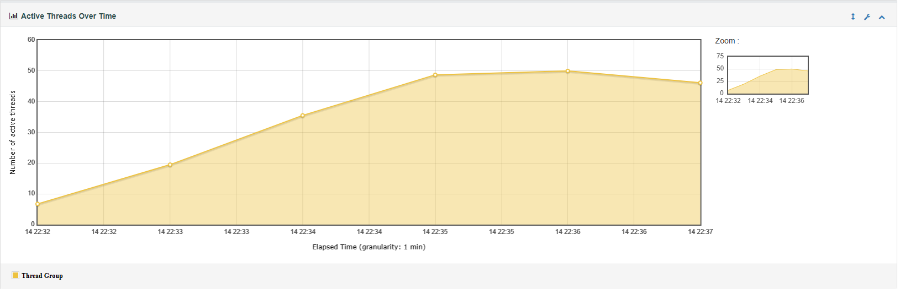

# 📚 Teste de Performance - BlazeDemo com Apache JMeter

## 🎯 Objetivo

Projeto de estudo utilizando Apache JMeter para praticar testes de performance em aplicações web.

O cenário simula múltiplos usuários executando o fluxo completo de compra de passagens da aplicação BlazeDemo, permitindo avaliar métricas como tempo de resposta, throughput, utilização de usuários virtuais e taxa de erros durante a execução.

---

## 🛠 Ferramentas Utilizadas

- Apache JMeter 5.6.3
- HTTP Request
- CSV Data Set Config
- Summary Report
- HTML Dashboard Report

---

## 📂 Fluxo Testado

O cenário executa as seguintes etapas da aplicação:

1. Acessar a página inicial
2. Buscar voo
3. Selecionar voo
4. Finalizar compra

Para tornar a execução mais próxima do uso real, foi utilizada parametrização através de arquivo CSV contendo diferentes origens e destinos.

---

## ⚙️ Configuração do Cenário

### Carga Aplicada

- 50 usuários virtuais (Threads)
- Ramp-Up: 180 segundos
- Duração: 300 segundos

### Massa de Dados

Os dados utilizados durante a execução são carregados por meio de CSV Data Set Config.

| Origem | Destino |
|----------|----------|
| Paris | London |
| Boston | Rome |
| Philadelphia | Berlin |
| Portland | Dublin |
| San Diego | New York |

### Simulação de Usuário

Foi utilizado Uniform Random Timer para inserir pausas entre as requisições e aproximar o comportamento de usuários reais.

- Espera mínima: 2 segundos
- Espera aleatória adicional: até 3 segundos

---

# 📊 Resultados Obtidos

## Resumo da Execução

| Métrica | Resultado |
|----------|----------|
| Total de Requisições | 2.611 |
| Tempo Médio de Resposta | 503 ms |
| Tempo Mínimo | 385 ms |
| Tempo Máximo | 1.825 ms |
| Taxa de Erro | 0,00% |
| Throughput | 8,8 transações por segundo |

## Análise dos Resultados

O teste executou o fluxo completo da aplicação durante todo o período configurado sem ocorrência de falhas.

A taxa de erro de 0% indica que todas as requisições foram processadas com sucesso durante o cenário de carga aplicado.

O throughput manteve aproximadamente 8,8 transações por segundo ao longo da execução, demonstrando capacidade de processamento consistente para o volume de usuários simulados.

O tempo médio de resposta foi de 503 ms, permanecendo abaixo de 1 segundo durante a maior parte da execução.

Os gráficos indicam comportamento estável da aplicação durante o aumento gradual da carga, sem degradações significativas de desempenho.

---

## 📈 Evidências

### Active Threads Over Time

O gráfico demonstra o crescimento gradual da carga até aproximadamente 50 usuários virtuais simultâneos, seguindo a configuração de ramp-up 
