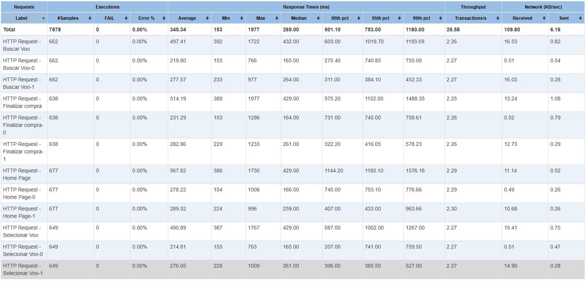
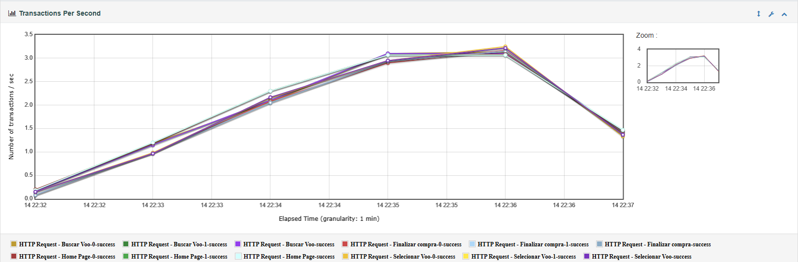

# 📚 Teste de Carga - BlazeDemo com Apache JMeter

## 🎯 Objetivo

Projeto de estudo desenvolvido com Apache JMeter para praticar testes de carga em aplicações web.

O cenário simula múltiplos usuários executando o fluxo completo de compra de passagens da aplicação BlazeDemo, permitindo coletar e analisar métricas de desempenho como throughput, tempo de resposta, percentis e taxa de erros.

---

## 🛠 Ferramentas Utilizadas

- Apache JMeter 5.6.3
- HTTP Request
- CSV Data Set Config
- Uniform Random Timer
- Summary Report
- HTML Dashboard Report

---

## 📂 Fluxo Testado

O teste simula o fluxo completo de compra de passagens:

1. Acessar página inicial
2. Buscar voo
3. Selecionar voo
4. Finalizar compra

---

## ⚙️ Configuração do Cenário

### Carga Aplicada

- 50 usuários virtuais (Threads)
- Ramp-Up: 180 segundos
- Duração: 300 segundos

### Massa de Dados

A execução utiliza dados parametrizados por meio de CSV Data Set Config.

| Origem | Destino |
|----------|----------|
| Paris | London |
| Boston | Rome |
| Philadelphia | Berlin |
| Portland | Dublin |
| San Diego | New York |

### Simulação de Usuário

Foi utilizado Uniform Random Timer para aproximar o comportamento de usuários reais.

- Espera mínima: 2 segundos
- Espera aleatória adicional: até 3 segundos

---

# 📊 Resultados Obtidos

## Resumo da Execução

| Métrica | Resultado |
|----------|----------|
| Total de Requisições | 7.878 |
| Taxa de Erro | 0,00% |
| Tempo Médio de Resposta | 345 ms |
| Tempo Mínimo | 153 ms |
| Tempo Máximo | 1.977 ms |
| Mediana | 269 ms |
| Percentil 90 (p90) | 501 ms |
| Percentil 95 (p95) | 753 ms |
| Percentil 99 (p99) | 1180 ms |
| Throughput | 26,58 transações por segundo |

---

## 📈 Evidências

### Statistics

Resumo consolidado das métricas coletadas durante a execução do teste, incluindo throughput, percentis, tempo médio de resposta e taxa de erros.

---

### Active Threads Over Time

O gráfico demonstra o crescimento gradual da carga até aproximadamente 50 usuários virtuais simultâneos, seguindo a configuração de ramp-up definida para o cenário.

---

### Transactions Per Second

Representa a quantidade de transações processadas por segundo scimento da quantidade de usuários ativos.

---

### Response Times Over Time

./reports/response-times-over-time.png

Mostra a evolução do tempo de resposta das requisições durante o teste. Apesar do aumento gradual da carga, os tempos permaneceram estáveis durante a execução.

---

## 🔍 Análise dos Resultados

O cenário executou o fluxo completo da aplicação sem ocorrência de falhas, registrando taxa de erro de 0%.

Foram processadas 7.878 requisições durante a execução, com throughput de aproximadamente 26,58 transações por segundo.

O tempo médio de resposta foi de 345 ms, enquanto 95% das requisições foram respondidas em até 753 ms (p95).

Os gráficos indicam comportamento estável da aplicação durante o aumento gradual da carga, sem degradação significativa de desempenho ou aumento expressivo da taxa de erros.

---

## ✅ Conceitos Praticados

- Testes de carga utilizando Apache JMeter
- Configuração de usuários virtuais (Threads)
- Ramp-Up e duração de testes
- Parametrização de dados com CSV
- Simulação de comportamento de usuários
- Throughput
- Tempo de resposta
- Percentis (p90, p95 e p99)
- Taxa de erros
- Geração de dashboards e relatórios
- Análise de métricas de performance

---

## 📌 Conclusão

Este projeto permitiu praticar a criação e execução de testes de carga utilizando Apache JMeter, além da interpretação de métricas e análise do comportamento da aplicação sob carga.

Durante a execução do cenário configurado, a aplicação manteve estabilidade, baixa latência e ausência de erros, demonstrando capacidade de processamento consistente para o volume de usuários simulados.
